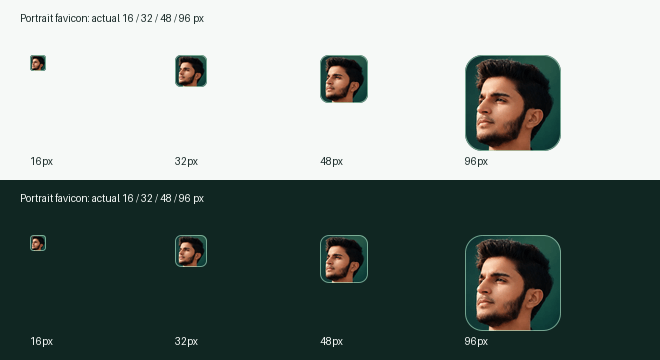

# Portrait favicon and SEO review

Reviewed 21 October 2026 against production `7e91bc8b94b8fed4ce9e322e1c005091578a6aeb` and the owner's portrait-favicon / branded-search request. This is a scoped asset and technical SEO refinement, not a design or indexing-policy change.

## Confirmed findings and decisions

- The old SVG, PNG and ICO icons all represented the Z monogram. All six existing icon URLs returned 200 with correct image MIME types, `index, follow` and `public, max-age=0, must-revalidate`. There is no confirmed current asset-access or caching defect explaining Google's globe.
- Fresh Search Console URL Inspection reported the homepage **Submitted and indexed**, crawl allowed, successful mobile fetch, and matching Google/user canonical `https://zainsaleem.co/`. Its last reported crawl was 20 October 2026. That indexed version predates the latest personal-brand refinement. Request a fresh homepage crawl after the favicon release; never claim Google has already adopted the portrait.
- The live 12-page on-page crawl found no critical/high/medium issues, no schema issues, self-canonicals and one H1 per page. The full 17-HTML HTTP audit also passed status, canonical, robots, schema and internal-link checks. The apparent source `_headers` noindex is the deliberate preview default; the existing production build and Worker apply the approved host/route policy. Do not replace it with a global index directive.
- Two homepage empty alt attributes belong to the decorative duplicate portrait layers inside `aria-hidden="true"`. Keep them decorative. The meaningful hero has accurate named alt text, explicit 1122 × 1402 dimensions, high fetch priority and no lazy loading. Decorative 620 × 775 images keep low priority. Both original WebP files are small (about 46KB and 18KB); no portrait display or image file was changed. The 1200 × 630 Open Graph artwork, dimensions, descriptive alternative text and stable URL remain intact.
- Short-title and low-word-count heuristics are not sufficient reasons to pad the Story or service pages. Preserve concise useful content. Only the two service descriptions below were tightened for clearer scope; no competing URLs or extra geographic pages were created.

## Reviewed favicon

The source is the authentic studio photograph `public/images/zain-hero-studio-2026.webp`. Three head-focused crops were inspected at 16/32/48/96 pixels; the tight 520 × 520 crop at left 380, top 270 retained the complete hairline and chin and gave the clearest small face. The lower-resolution cutout was rejected because its existing alpha edge is less suitable at tiny sizes. Only deterministic crop, resize, rounded mask, subtle mint outline and PNG palette compression are applied; no generated face, retouching, recoloring or source-photo replacement.

Run `node scripts/generate-brand-assets.mjs` to regenerate. It uses the existing Sharp dependency and does not alter the independent social artwork unless `--social-preview` is explicitly passed. Apple receives an opaque 180px square so the OS can apply its own corner treatment.

HTML declares the multi-size ICO fallback, primary 96px PNG and Apple touch icon only. The former SVG URL now embeds the same portrait for old cached pages, but is absent from new favicon declarations. All URLs remain stable; no cache-busting URL rotation or DNS/security changes are needed.

## Metadata refinement

Titles and the other page descriptions remain unchanged. These descriptions share the same centralized Open Graph/Twitter values; service keyword intent and schema IDs are retained.

| Page                       | Before                                                                                                                                                             | After                                                                                                                                                     |
| -------------------------- | ------------------------------------------------------------------------------------------------------------------------------------------------------------------ | --------------------------------------------------------------------------------------------------------------------------------------------------------- |
| `/services/technical-seo/` | Find and prioritize technical SEO issues with Zain Saleem: crawling, indexing, canonicals, internal links, structured data, performance and implementation checks. | Technical SEO audits and implementation with Zain Saleem. Review crawling, indexing, canonicals, internal links, structured data and website performance. |
| `/services/local-seo/`     | Improve your local search foundations with Zain Saleem. Review business information, service-area content and listings around your actual services and customers.  | Local SEO services with Zain Saleem. Review business information, Google Business Profile, website content and listings around your real service areas.   |

The Local SEO scope now explicitly names **reviewing Google Business Profile information**, supported by the existing verified local SEO/GBP capability. It does not promise certification, map positions or a broader invented deliverable. Neither description is a ranking guarantee or a response to a validated keyword-volume opportunity.

## Entity and intent review

The existing Person, WebSite, ProfilePage, WebPage, Service, BreadcrumbList and service-directory ItemList graphs already reflect the visible content. No new schema entities were needed. WebSite name and `og:site_name` remain **Zain Saleem**, publisher/provider/about relationships reference stable `/#person`, and Person uses the existing real portrait. Head of SaaS remains the accurate job title. No employer `worksFor`, anonymous Organization, invented LinkedIn identity, awards, reviews, locations or credentials were added. Regression tests now explicitly verify the identity, image, capabilities and publisher relationships.

The homepage owns branded identity; About covers the person/approach, Experience the professional record, My Story the seven-chapter narrative and Expertise the working method. These supporting pages should not all target the same commercial service phrase.

## Candidate keyword-to-page map

Connected Search Console returned no settled query rows for its latest 28-day window (through 18 October 2026, before public search launch). No reliable search volumes, difficulty scores or conversion data were available. The mapping below is based on existing service scope and semantic intent, **not validated keyword demand or a priority ranking**. Reassess with actual page/query impressions before expanding content.

| Candidate topic                                               | Existing primary page         | Intent and boundary                                                                                                         |
| ------------------------------------------------------------- | ----------------------------- | --------------------------------------------------------------------------------------------------------------------------- |
| Zain Saleem; SaaS development, AI automation and SEO strategy | `/`                           | Main branded destination; links to the service directory.                                                                   |
| SaaS development services                                     | `/services/saas-development/` | Building a product and its core workflows; preserve AI-assisted scope.                                                      |
| AI automation services; business workflow automation          | `/services/ai-automation/`    | Connecting tools, handoffs, repetitive processes and human checks.                                                          |
| Custom business software development                          | `/services/custom-software/`  | Internal applications and API integrations around a business workflow.                                                      |
| Technical SEO services; technical SEO audits                  | `/services/technical-seo/`    | Audit, prioritization, implementation support and verification. One page covers both topics.                                |
| Local SEO services; Google Business Profile optimization      | `/services/local-seo/`        | Local foundations and GBP information review; validate demand and agreed delivery scope before broader optimization claims. |
| Link building services; off-page SEO services                 | `/services/link-building/`    | Relevant research, transparent outreach and quality criteria. One page covers both topics.                                  |
| Compare software, automation and SEO services                 | `/services/`                  | Directory/navigation intent; does not duplicate each service's primary targeting.                                           |

## Performance and remaining gaps

[Live PageSpeed report](https://pagespeed.web.dev/analysis/https-zainsaleem-co/q17kly5f4u?form_factor=desktop), 21 October 2026 at 18:46 PKT, Lighthouse 13.5.0:

| Lab measurement     | Mobile (slow 4G, Moto G Power) | Desktop   |
| ------------------- | ------------------------------ | --------- |
| Performance         | 97                             | 99        |
| Accessibility / SEO | 100 / 100                      | 100 / 100 |
| LCP                 | 2.0s                           | 0.4s      |
| CLS                 | 0                              | 0.013     |
| Total blocking time | 0ms                            | 90ms      |
| Best Practices      | 92                             | 92        |

These are lab observations, not real-user Core Web Vitals or an INP measurement. PageSpeed reports **No Data** for real users. The GSC Wizard CrUX API key is not configured; the public PageSpeed report independently confirms no field data. Do not label Core Web Vitals as passed. Chrome DevTools MCP is unavailable, so this is a public Lighthouse report, not a DevTools trace.

The Best Practices console warning is the **pre-existing Cloudflare-injected analytics beacon blocked by the current CSP**. Resolving that conflict needs a separately scoped analytics/security decision; no policy or Cloudflare setting was changed to improve the score. Lighthouse's image-delivery and CSS opportunities are potential future performance work, not confirmed regressions from this change. Strong current LCP/CLS and the instruction to preserve the approved imagery/layout do not justify a page-image redesign here.

There are no approved public case studies and Insights has no substantive articles yet. Evidence-backed examples and useful writing may strengthen service credibility when rights and facts are approved; do not fabricate them or publish placeholder content. LinkedIn remains unverified and absent. Backlink authority and competitive keyword demand were not measured, so no authority or ranking gains are claimed.

## Release checks and Search Console follow-up

Require install, typecheck, lint, format, both builds/generated metadata, the complete Playwright suites and local preview/production Worker header checks before merge. Keep all eight zero-difference visual scenarios and their references unchanged unless an actual reviewed UI difference requires otherwise. New tests decode every icon, inspect all ICO frames, verify original-photo hashes, check favicon declarations across every page and preserve meaningful/decorative image semantics. Worker tests verify icon status, MIME, security and production/preview robots behavior.

After deployment, compare all production icon bytes/hashes against the reviewed files and the old asset hashes, inspect response MIME/dimensions/cache behavior, and recheck metadata, live HTTP directives, robots, sitemap and stable schema. Verify the rendered site in a real browser.

In Search Console, inspect `https://zainsaleem.co/`, run **Test live URL**, confirm successful fetch/indexability/canonical, then choose **Request indexing**. Confirm the existing sitemap remains successful; resubmission is optional, not a substitute for homepage inspection. Monitor indexing and page/query reports after processing. Google decides whether and when a favicon or preferred site name appears; a recrawl request does not guarantee an immediate search-result change.

Sources: [Google favicon guidelines](https://developers.google.com/search/docs/appearance/favicon-in-search), [Google site-name guidelines](https://developers.google.com/search/docs/appearance/site-names), connected Search Console inspection/on-page/query results and the live PageSpeed report above.

## Reviewed asset integrity

Original portrait sources remain unchanged. SHA-256 identifies the reviewed files below; verify deployed bytes against these references.

| Asset                                      | Bytes | SHA-256                                                            |
| ------------------------------------------ | ----- | ------------------------------------------------------------------ |
| `public/images/zain-hero-studio-2026.webp` | 46084 | `3843c9d8ab178cae7a3498133497178c883f1d497fbdacb19e4c7cec91917bb2` |
| `public/images/zain-portrait.webp`         | 18140 | `554110be131c7da9a61be1e0271e9d0af36a0589d30a88b8210fe236cb08798f` |
| `public/favicon-32.png`                    | 1890  | `26db28cf701c20f21524eb89432921cd6d57eeb0b4223701a80eee0a39e5c628` |
| `public/favicon-48.png`                    | 2898  | `af7ef6764e43e39f0488561f377ca0afbbba9a177872f566437234dc45207b50` |
| `public/favicon-96.png`                    | 7180  | `b7d189cbfe5d4806a188aad7d64acb8db852200f36918cf03c27a80494ed32fd` |
| `public/favicon.ico`                       | 13186 | `75a3f96b91e342ee58fbad71c941984d5f36db4dc3f00e61692fae6a7ce9958d` |
| `public/apple-touch-icon.png`              | 18822 | `f29c6798e2ca851bc1e1ed5c5dfbb68c44b9b9892c34b7f6fa825c4f525bfc69` |
| `public/favicon.svg`                       | 9727  | `a4fb52b2d2d28a6f5529867cd69e4ccbd246b23d977c4e60385d0edf49820306` |
